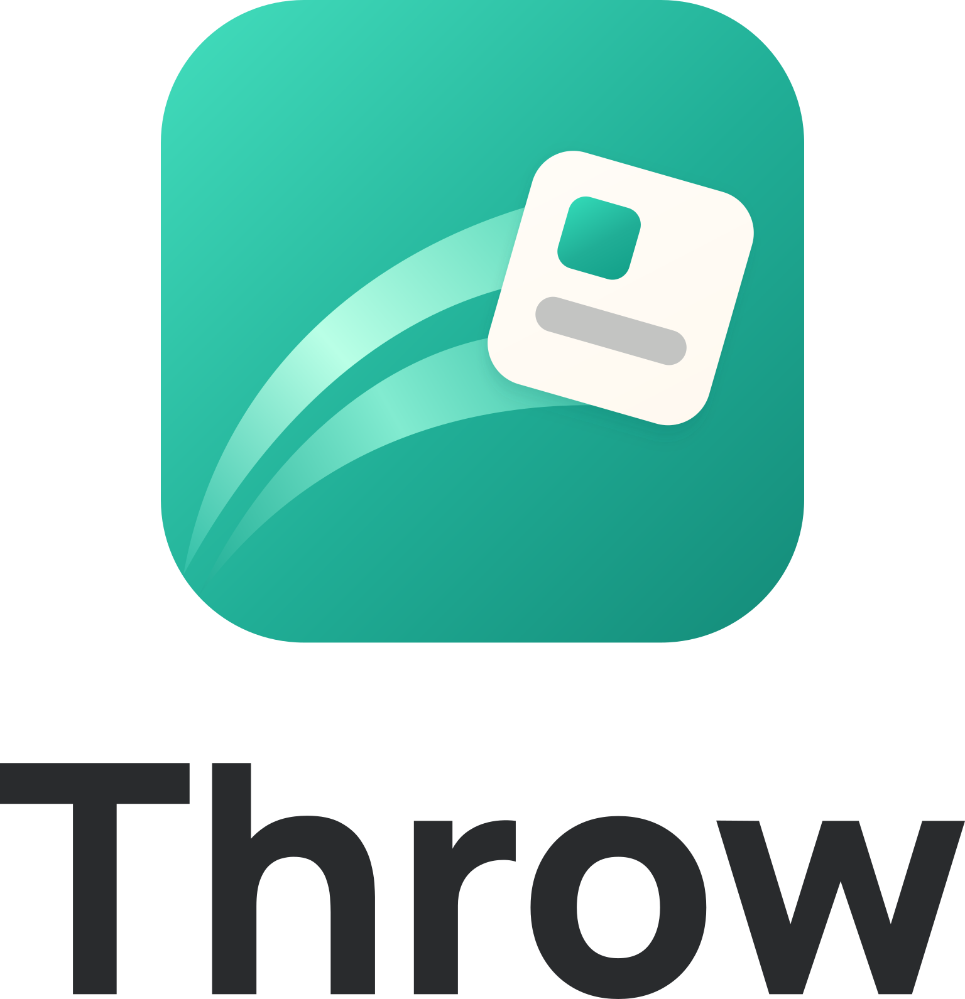
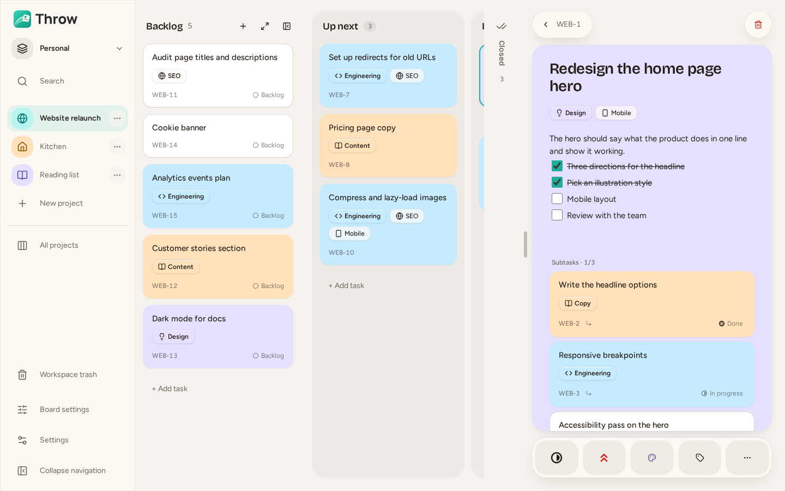
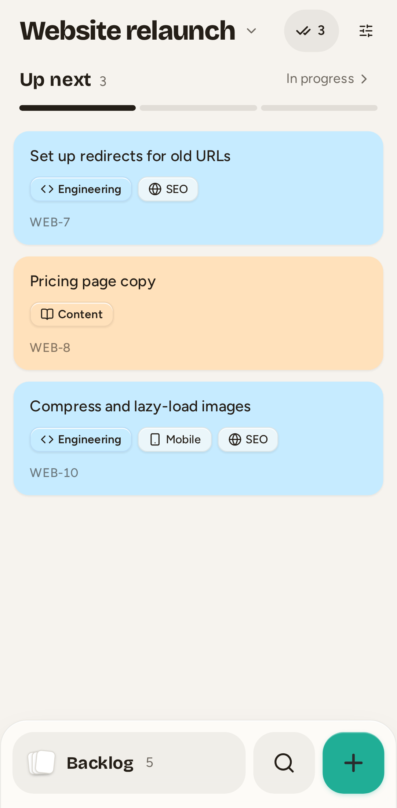
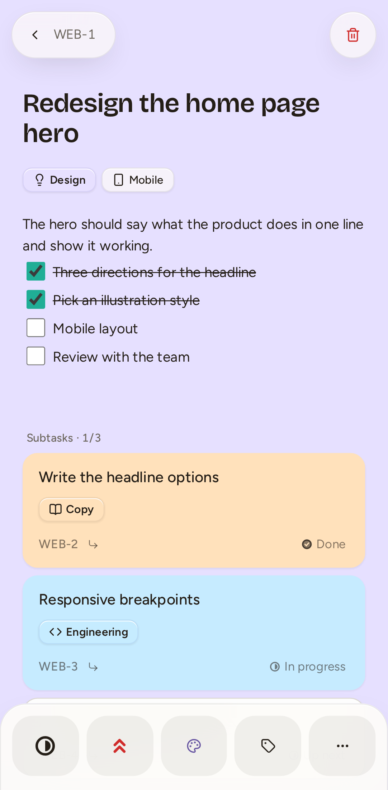
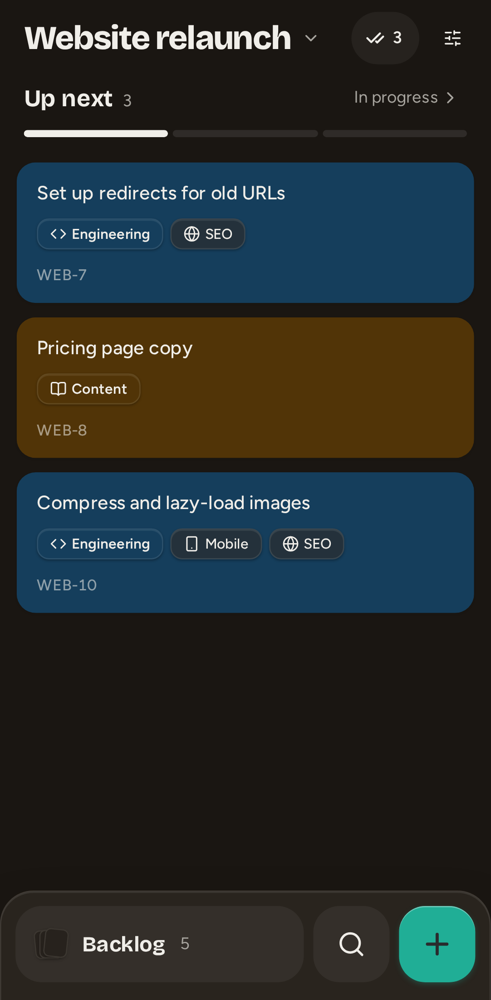

<h1 align="center">
  <picture>
    <source media="(prefers-color-scheme: dark)" srcset="apps/web/public/wordmarks/throw-lockup-stacked-stable-light.svg" />
    
  </picture>
</h1>

Throw is a project board you host yourself. Your projects and tasks live on a server you
control, and they keep working on your phone or laptop when you are offline. It is a
companion to [Catch](https://github.com/iiloni/catch): Catch holds notes and loose ideas,
and Throw holds work whose progress matters to a project.

It runs in any modern browser, installs as an app from the browser (PWA), and has a native
Android app.

<p align="center">
  <picture>
    <source media="(prefers-color-scheme: dark)" srcset="docs/screenshots/readme/desktop-task-dark.png" />
    
  </picture>
</p>

<p align="center">
  
  &nbsp;
  
  &nbsp;
  
</p>

## What it does

- **A board that is the product.** Columns for your own statuses, grouped as backlog,
  active and closed, with priority zones inside each column. Cards move by drag, keyboard,
  long press on a phone, or a swipe to close.
- **Tasks you work in.** Each task opens beside the board (or full screen on a phone) with a
  rich-text description, one level of subtasks, comments and a full history of what changed.
- **Works offline.** Everything is kept on the device. Changes made without a connection are
  sent when it comes back, and a change that conflicts with newer work is never applied
  over it.
- **Tags and colours.** Nested tags per project. A task's colour comes from its primary tag,
  and further tags sit on its card.
- **Every project at once.** A cross-project board shows the whole workspace by category.
- **Search everywhere.** A command palette finds tasks, projects and actions.
- **Trash with restore.** Deleted tasks and projects can be brought back until you empty
  the trash.
- **Backups built in.** Admins back up and restore the whole server from Settings, by hand
  or on a schedule.

Throw leaves out what makes most project tools heavy: no integrations, automations, sprints
or reports. See the [spec](docs/spec.md) for what is planned and what is out of scope.

## Get Throw

Throw has no hosted service: you need a Throw server, either your own or one somebody runs
for you.

- **In a browser:** open your server's address and sign in. Your browser can install it as
  an app from there.
- **On Android:** download the APK from the
  [latest release](https://github.com/iiloni/throw/releases/latest), install it and enter
  your server's address on first launch. Later versions are offered in Settings > Update.

Every version is listed with its changes on the
[releases page](https://github.com/iiloni/throw/releases). Versions marked *preview* come
out ahead of stable ones and install as a separate Throw Preview app.

## Run your own server

Throw runs with Docker Compose on any machine that can stay on, such as a home server or a
small VPS, and it can share a machine and a Postgres container with Catch.

**[Deployment guide](docs/deployment.md)** covers installation, HTTPS, settings, backups
and updates. The first account becomes the admin, and sign-up then closes.

## Work on Throw

Throw is a TypeScript project: a React web app, a Node server and an Android app built from
the same code. The whole development environment starts with one command in Docker, and
each Git worktree gets its own stack.

```bash
./scripts/dev.sh up    # this checkout's stack; prints its URL
./scripts/dev.sh check # lint, typecheck, unit tests, build
```

**[Development guide](DEVELOPMENT.md)** covers setup, tests, the Android app and how
changes get merged. [AGENTS.md](AGENTS.md) describes the architecture and conventions.

> [!NOTE]
> Throw is not accepting external contributions at the moment. You are welcome to read the
> code, run it and fork it under the license below.

## AI development notice

Throw is developed primarily with AI coding tools. The maintainer designs the product, its
frontend and its backend, and directs agents through implementation. Code quality is
validated through manual and automated testing and supplemental AI review. As with all
self-hosted projects, you are encouraged to keep regular backups of your Throw server.

## More documentation

| For | Read |
| --- | --- |
| Server admins | [Deployment](docs/deployment.md), [Server backups](docs/backups.md), [Releases and channels](docs/releases.md) |
| Contributors | [Development](DEVELOPMENT.md), [Architecture and conventions](AGENTS.md), [Product spec](docs/spec.md), [Data model](docs/data-model.md), [Design decisions](docs/decisions), [Pull requests and CI](docs/ci.md) |

## License

[MIT](LICENSE)
