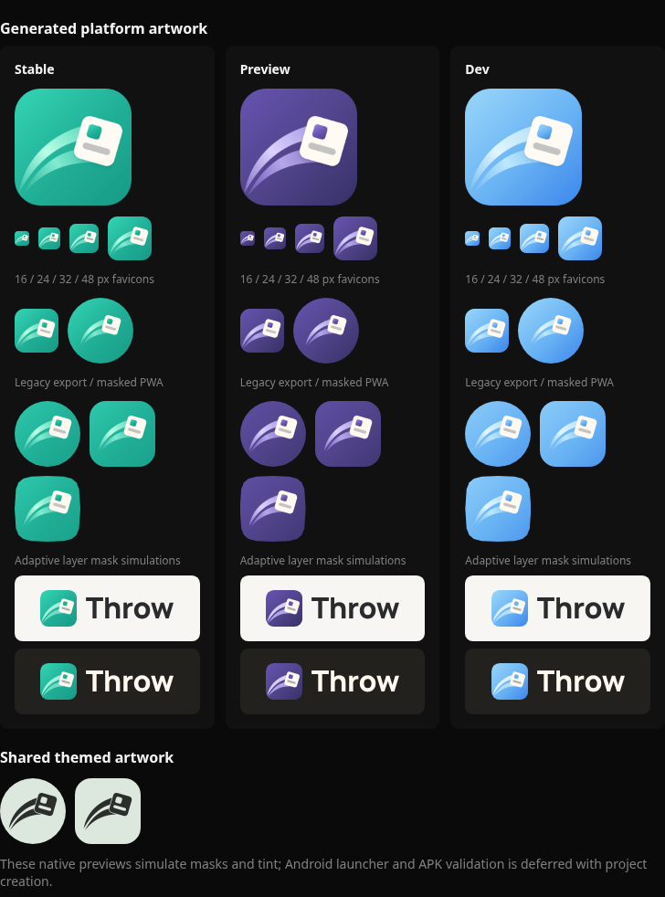

# Branding integration validation

Validated on 2026-10-13. Android project creation remains deferred by request.

## Changed files

| Files | Change |
| --- | --- |
| `throw-brand/` | All 118 supplied files preserved byte for byte, including the complete source-of-truth package, tools and manifests |
| `scripts/generate-brand-assets.mjs` | Mechanical source-integrity check and SVG/PNG/ICO/native-resource generation for all three treatments |
| `apps/web/public/` | Stable, preview and dev icons, favicons, touch/maskable assets and portable outlined lockups/monochrome symbols |
| `branding/android/app/src/` | Staged density PNGs and shared API 26/33 adaptive XML; no Android project generated |
| `apps/web/vite.config.ts`, `apps/web/index.html` | Existing channel selection wired to manifest icons, favicons and Apple touch icons |
| `apps/web/src/styles.css`, `apps/web/src/components/ui/button.tsx` | Approved jade actions, links, focus and selected/hover states with a readable primary-button hover fill |
| `apps/web/src/components/BrandLockup/` | Responsive, theme-aware supplied artwork with detail/minimum-size handling and tests |
| `apps/web/src/routes/login.tsx`, `setup.tsx`, `apps/web/src/components/AppShell/` | Branding on the sign-in, server-setup and navigation-rail surfaces |
| `apps/web/src/components/AppShell/`, `Dock/`, `ShellForms/`, `apps/web/src/routes/_app/settings.tsx` | Jade selected and hover surfaces on the rail, dock indicator, shell menu, icon grid and theme choice |
| `scripts/brand-assets.test.ts`, `e2e/branding.spec.ts` | Favicon, mask/safe-zone, themed-alpha, theme-preference and narrow/offline-layout checks |
| `package.json`, `pnpm-lock.yaml`, `biome.json` | Locked renderer dependency, generation/integrity commands and protection against formatting the source package |
| `docs/branding.md`, `docs/spec.md`, `docs/decisions/0001-stack.md`, this report and `docs/branding/` | Integration/regeneration instructions, explicit UI palette, validation and painted screenshots |

Catch's local integration, branding documentation/generator and active
[PR #112](https://github.com/iiloni/catch/pull/112) were inspected read-only. No Catch file
was modified. Its icon-preference feature was not ported. Throw retains its existing
build identities, explicit channel selection and distribution behavior.

## Exact commands and results

```bash
python3 throw-brand/tools/derive-assets.py --check
node scripts/generate-brand-assets.mjs
node scripts/generate-brand-assets.mjs --check
./scripts/dev.sh check
./scripts/dev.sh build stable
./scripts/dev.sh build preview
./scripts/dev.sh build dev
./scripts/dev.sh e2e e2e/branding.spec.ts e2e/auth.spec.ts --workers=1
E2E_FIREFOX=1 ./scripts/dev.sh e2e e2e/branding.spec.ts --workers=1
```

- Source derivation: all 57 derived SVGs and their integrity manifest pass. All 118 source
  files were also compared directly against the attached ZIP, with exact byte equality.
- Platform generation/check: all 129 outputs pass with sharp 0.35.5 and librsvg 2.63.2.
- Required repository check passes: platform integrity, lint, typechecks, unit tests and
  production builds. Nine lockup tests and three raster/ICO/alpha tests cover this change.
- Stable, preview and dev builds pass. Generated HTML favicon/touch links and manifest
  icon paths were checked for each channel. Names, launch URL and background colors remain
  unchanged; the manifest theme color now uses the approved jade `#20AE96`. The maskable
  purpose and icon/lockup precache entries were verified.
- Targeted Chromium auth/branding: five passed, one existing mobile redirect case skipped
  because it is layout-independent. The final branding run, including the 320 px header
  with an unsaved offline write, passes on Chromium desktop, Chromium's Android layout and
  Firefox: three passed. Browser versions: Chrome for Testing 153.0.8010.12, Firefox 155.0.
- After the rebase onto the navigation shell, the same three-project branding run also
  checks that the current rail destination, the dock indicator and the pressed theme choice
  paint the jade selected surface, that selection leaves the previous rail item, and that
  rail and theme lettering keep 4.5:1 on it. It also checks that the expanded rail shows
  the lockup and the collapsed rail the loaded mark alone, centred on the icon column.
  Auth and project specs were rerun on Chromium.
- The final jade-palette run checks normal and hovered primary-button text and link text
  against a 4.5:1 contrast floor, plus keyboard-focused input borders against a 3:1 floor,
  on actual light/dark rendered surfaces in all three browser/layout projects.
- Ordinary icons, small/micro favicons, maskable surfaces, composed adaptive layers,
  shared themed alpha and light/dark lettering were visually inspected for all channels.
  Painted application screenshots were inspected as well.

The local E2E suite was targeted; the full suite remains the pre-merge CI guard. Earlier
test-harness theme resets were corrected. The phone header carries no artwork, so the
320 px offline check now covers the workspace line beside the sync indicator.

## Representative painted screenshots

[All-channel platform proof](branding/platform-proof.png) includes actual generated web
and native resources. Native masks/tint in this proof are simulations, not launcher captures.



[Desktop sign-in, light](branding/sign-in-light.png),
[phone sign-in, dark](branding/sign-in-dark-phone.png),
[phone server setup, dark](branding/server-setup-dark-phone.png), and
[narrow offline header](branding/header-offline-narrow.png) show the existing app surfaces.
[Desktop shell, dark](branding/shell-dark-desktop.png),
[collapsed rail](branding/shell-collapsed-dark-desktop.png) and
[phone shell, dark](branding/shell-dark-phone.png) show the rail lockup and selected
states. `docs/screenshots/app-shell/` predates the jade palette.

## Unavailable validation

No Android project, APK packaging, Gradle checks, system splash or emulator/physical
launcher tests were performed. The resources are staged for the future project, with
shared monochrome knockouts preserved and no extra adaptive inset/mask. Actual Android
masking, tinting, launcher presentation and system splash must be verified after wiring.

No installed-PWA OS icon refresh or physical iOS touch-icon test was performed. Native
WebView behavior is untested; setup/sign-in use the same web SVG surfaces. The source
package's font/license remains provenance only. The separately approved jade UI accents
are authored in application CSS; warm surfaces, typography, project/tag colors and
semantic error colors retain the existing values. Canonical/channel artwork is unchanged.
